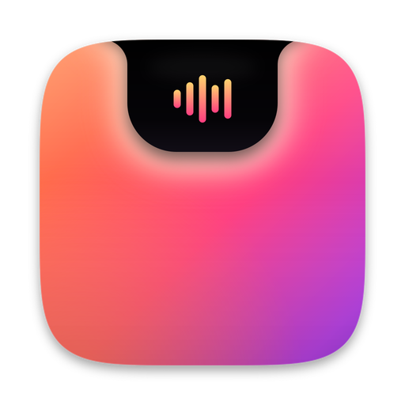
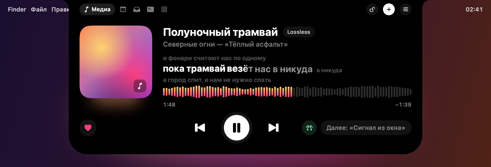
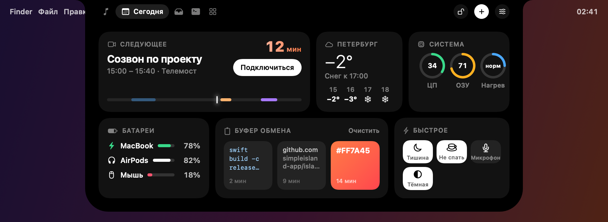
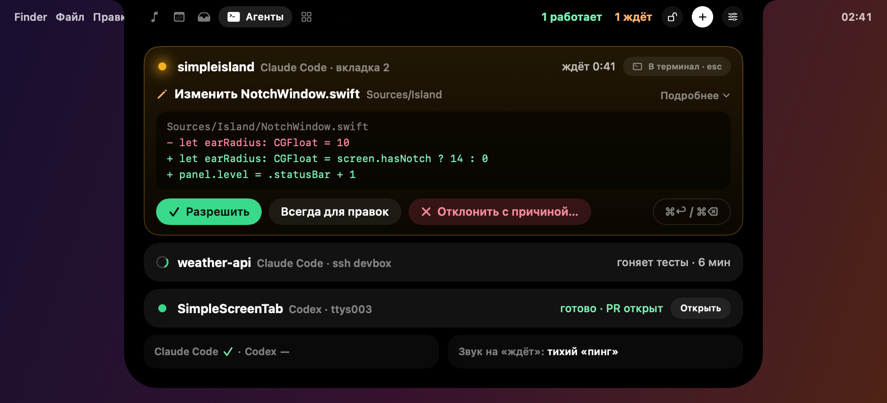
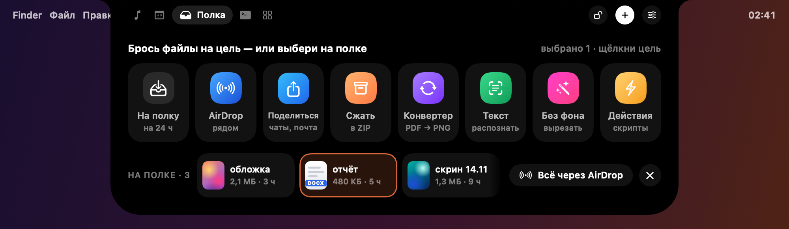

<p align="center"></p>

# SimpleIsland

**[Русская версия ниже](#русский)**

SimpleIsland turns the MacBook notch into a Dynamic Island: what is playing with lyrics synced to the music, your day at a glance, a shelf for files, live Claude Code and Codex sessions with one-click permissions, clean volume and brightness indicators, and a tidy menu bar. On Macs without a notch it sits at the top of the screen the same way.

Written in Swift, built with SwiftPM, no telemetry, no account, no paid tiers. A free, open-source alternative to NotchNook, Alcove and Boring Notch. The interface is in Russian for now.



## Download

| Platform | File | Install |
|---|---|---|
| macOS 15+ (Apple Silicon + Intel) | [SimpleIsland-1.0.0.zip](https://github.com/k33ssa/SimpleIsland/releases/download/v1.0.0/SimpleIsland-1.0.0.zip) | `brew install --cask k33ssa/tap/simpleisland` |

All versions: [Releases](https://github.com/k33ssa/SimpleIsland/releases).

## Install / Update

**Homebrew** (recommended, updates with `brew upgrade`). Homebrew 7+ asks you to trust a third-party tap once:

```bash
brew trust k33ssa/tap
brew install --cask k33ssa/tap/simpleisland
```

**Download:** grab `SimpleIsland-x.y.z.zip` from [Releases](https://github.com/k33ssa/SimpleIsland/releases/latest), move `SimpleIsland.app` to Applications and open it. The app is free and not notarized, so if macOS refuses to open it, run `xattr -dr com.apple.quarantine /Applications/SimpleIsland.app` once.

**Build from source in one line** (needs Xcode Command Line Tools; re-run to update):

```bash
curl -fsSL https://raw.githubusercontent.com/k33ssa/SimpleIsland/main/install.sh | bash
```

macOS asks for each permission when a feature first needs it (see [Permissions](#permissions)). The app turns on "Open at login" by itself on first launch; you can switch it off in the app's settings.

To uninstall: `brew uninstall --cask simpleisland`, or for a source build:

```bash
curl -fsSL https://raw.githubusercontent.com/k33ssa/SimpleIsland/main/install.sh | bash -s -- uninstall
```

Settings stay in `~/Library/Application Support/SimpleIsland`; add `--purge` after `uninstall` to remove them too.

**Auto-update.** `brew upgrade` picks up new versions; to let Homebrew update everything by itself in the background (once a day), run once:

```bash
brew tap homebrew/autoupdate && brew autoupdate start --upgrade --cleanup
```

## What it does

- **Media** — cover, controls, seek bar and output device for Music, Spotify and browsers; song lyrics from several open sources, synced word by word with the sound, animated like in Apple Music.
- **Today** — next calendar event with a "Join" button, weather, system load, batteries of the Mac and AirPods, clipboard history, quick toggles.
- **Shelf** — drop files on the notch and keep them there; AirDrop, zip, image conversion, text recognition (OCR), background removal, your own actions.
- **Agents** — live Claude Code and Codex sessions: what each one is doing, permission requests with the diff, questions with answer buttons, plans. Approve in one click without switching to the terminal. The hooks are installed only when you press the button.
- **Indicators** — volume, brightness, keyboard backlight, charging, headphones with AirPods battery, keyboard layout, Caps Lock, camera and microphone in use — neatly around the notch instead of the system pop-ups.
- **Menu bar cleanup** — move extra menu bar icons into the island, hide them or quit their apps; see what macOS hides behind the notch.
- **Widget catalog** — optional widgets: a Music equalizer with a live spectrum and a status widget for [Vafa](https://github.com/k33ssa/vafa).
- 17 themes, multi-display support, VoiceOver labels, reduced motion.

<p align="center">  </p>

## Why

The notch takes the middle of the menu bar and gives nothing back. Notch apps that do something useful with it are mostly paid or closed, and none of them shows what coding agents are waiting for. SimpleIsland does it in one small native app.

## Requirements

- macOS 15 Sequoia or newer, Apple Silicon or Intel. Tested on macOS 27.
- Works with or without a notch.

## Permissions

All are optional; a feature that needs one asks when you first use it.

| Permission | Why |
|---|---|
| Accessibility | menu bar cleanup (reading and moving menu bar icons), media keys |
| Calendars | the next event in Today |
| Automation (Apple Events) | controlling Music and Spotify, jumping to an agent's terminal window, dark mode toggle |
| Bluetooth | headphones and AirPods battery |
| Camera | the "mirror" — only while you have it open |
| Apple Music | word-synced lyrics from your Apple Music subscription (no password, no library access) |
| Screen & System Audio Recording | equalizer spectrum (levels only, nothing is recorded or sent) |

## Build from source

```bash
git clone https://github.com/k33ssa/SimpleIsland.git
cd SimpleIsland
./build.sh
```

`build.sh` builds a release with SwiftPM, assembles `/Applications/SimpleIsland.app`, signs it (ad-hoc unless you have a local signing certificate), installs a Login Item and starts it. `./build.sh --no-launch` only builds; `SIMPLEISLAND_PREFIX=~/Desktop ./build.sh` puts the app elsewhere without starting it.

Self-tests run without windows or permissions: `swift build && .build/debug/SimpleIsland --selftest-core all` (also `--selftest-media`, `--selftest-hud`, `--selftest-shelf`, `--selftest-agents`, `--selftest-today`, `--selftest-settings`, `--selftest-catalog`, `--selftest-menubar`).

### For teams using Sten

The island has an optional **Meetings** widget for teams that run a self-hosted Sten meeting-minutes server: record a meeting from the notch and get the summary, decisions and tasks per person. It is not part of the regular build. To install a build with it:

```bash
curl -fsSL https://raw.githubusercontent.com/k33ssa/SimpleIsland/main/install.sh | bash -s -- --with-meetings --meetings-server https://<your-sten-host>/sten
```

The address is only a default and can be changed in the widget. The microphone permission is requested only in this build.

## How it works

- A borderless panel above the menu bar, drawn with SwiftUI and Core Animation; it follows displays, sleep and full-screen spaces.
- Now playing comes from MediaRemote through a small helper library (`Helpers/MediaRemote`), with AppleScript as a fallback.
- Lyrics: the bundled LyricsCore engine (TTML/LRC parsing, matching, a cascade of sources, cache).
- Agents: Claude Code / Codex hooks call the same binary (`SimpleIsland --hook <Event>`), which talks to the island over a Unix socket.
- Every feature is a separate SwiftPM module that depends only on `IslandCore`.

## License

MIT. Do what you like. This is original code; `Vendor/LyricsCore` is the author's own package (MIT), third-party ideas are listed in [THIRD_PARTY.md](THIRD_PARTY.md).

## Keywords

dynamic island mac, macbook notch app, notch utility, notchnook alternative, alcove alternative, boring notch alternative, apple music lyrics mac, synced lyrics menu bar, now playing notch, claude code notifications, codex approvals, volume hud mac, menu bar cleanup, file shelf mac

---

<a id="русский"></a>

## Русский

**SimpleIsland** — «Dynamic Island» для выреза MacBook: что играет, с текстом песни синхронно со звуком; день одним взглядом; полка для файлов; сессии Claude Code и Codex с разрешениями в один клик; аккуратные индикаторы громкости и яркости; уборка строки меню. На Mac без выреза остров так же живёт вверху экрана. Бесплатно, открытый код, без телеметрии, аккаунтов и платных уровней. Замена NotchNook, Alcove и Boring Notch.

### Скачать

| Система | Файл | Установка |
|---|---|---|
| macOS 15+ (Apple Silicon и Intel) | [SimpleIsland-1.0.0.zip](https://github.com/k33ssa/SimpleIsland/releases/download/v1.0.0/SimpleIsland-1.0.0.zip) | `brew install --cask k33ssa/tap/simpleisland` |

### Установка и обновление

Homebrew 7+ один раз просит довериться стороннему tap:

```bash
brew trust k33ssa/tap
brew install --cask k33ssa/tap/simpleisland
```

- Обновление: `brew upgrade --cask simpleisland`
- **Автообновление** в фоне (раз в сутки), выполнить один раз: `brew tap homebrew/autoupdate && brew autoupdate start --upgrade --cleanup`
- Удаление: `brew uninstall --cask simpleisland`

Без Homebrew: скачать zip, перенести SimpleIsland.app в «Программы» и открыть. Приложение бесплатное и не заверено Apple; если macOS не даёт его открыть, один раз выполнить `xattr -dr com.apple.quarantine /Applications/SimpleIsland.app`.

Из исходников одной строкой: `curl -fsSL https://raw.githubusercontent.com/k33ssa/SimpleIsland/main/install.sh | bash` (удаление — `… | bash -s -- uninstall`, с `--purge` — вместе с настройками). Автозапуск остров включает сам при первом запуске; выключить — переключатель «Запускать при входе» в настройках.

Права macOS спрашивает, когда функции они впервые нужны: Универсальный доступ (уборка строки меню, медиаклавиши), Календарь («Сегодня»), Автоматизация (Музыка, Spotify, окно терминала агента), Bluetooth (заряд AirPods), Камера («зеркало», только пока открыто), Apple Music (пословные тексты), запись звука системы (спектр эквалайзера, только уровни).

### Что умеет

- **Медиа** — обложка, управление, перемотка, устройство вывода; тексты песен из нескольких открытых источников, синхронно со звуком, анимация как в Apple Music.
- **Сегодня** — ближайшая встреча с кнопкой «Подключиться», погода, нагрузка, батареи, буфер обмена, быстрые тумблеры.
- **Полка** — бросить файлы на остров; AirDrop, zip, конвертер, распознавание текста, удаление фона, свои действия.
- **Агенты** — сессии Claude Code и Codex: что делают, запросы разрешений с diff, вопросы с кнопками, планы — ответить в один клик.
- **Индикаторы** — громкость, яркость, подсветка, зарядка, наушники, раскладка, Caps Lock, камера и микрофон — вокруг выреза вместо системных окошек.
- **Значки строки меню** — лишние значки в остров, спрятать или закрыть; видно, что macOS прячет под вырезом.
- **Каталог виджетов** — эквалайзер Музыки со спектром, статус [Vafa](https://github.com/k33ssa/vafa).

### Для команд со Sten

Виджет «Встречи» (запись встречи и протокол на своём сервере Sten) в обычную сборку не входит. Поставить сборку с ним:

```bash
curl -fsSL https://raw.githubusercontent.com/k33ssa/SimpleIsland/main/install.sh | bash -s -- --with-meetings --meetings-server https://<адрес-sten>/sten
```

### Сборка

`git clone https://github.com/k33ssa/SimpleIsland.git && cd SimpleIsland && ./build.sh` — нужны только Xcode Command Line Tools (SwiftPM, без Xcode-проекта).

### Лицензия

MIT. Код свой; `Vendor/LyricsCore` — собственный пакет автора (MIT), сторонние идеи — в [THIRD_PARTY.md](THIRD_PARTY.md).
